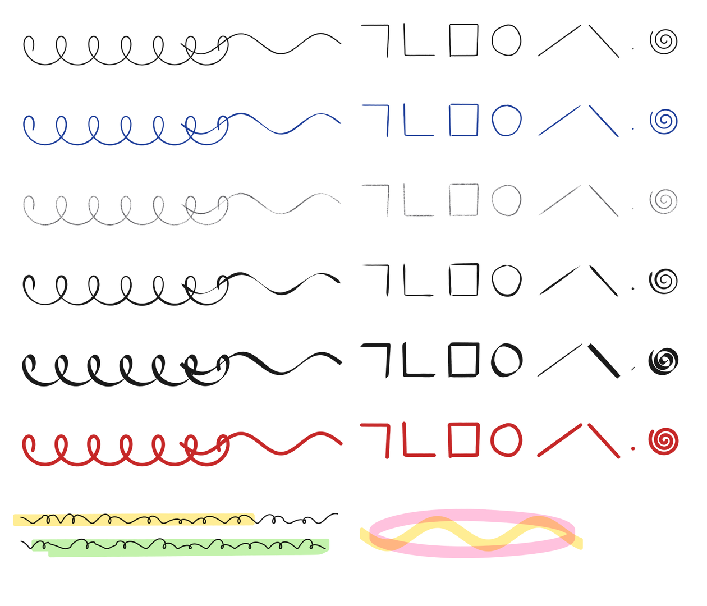
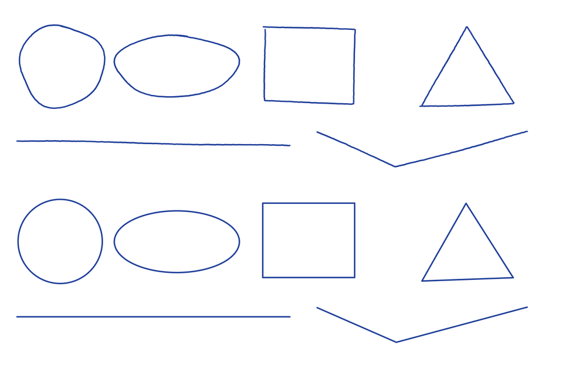

# note-apple

iPad 필기 앱 프로젝트입니다. 첫 단계로 앱의 핵심인 **필기 엔진(InkEngine)** 을
크로스 플랫폼 C++17로 작성했습니다. 외부 의존성이 없고, iPadOS(Swift/Metal)뿐 아니라
Android·Windows·macOS·Web(WASM)에서도 같은 코드로 같은 필기감을 냅니다.



위에서부터 볼펜 · 만년필 · 연필 · 붓펜 · 캘리그라피 · 마커 · 형광펜.
모든 이미지는 합성 Apple Pencil 입력(240 Hz, 센서 노이즈·손떨림·필압 변화 포함)을
엔진에 넣고 레퍼런스 래스터라이저로 렌더링한 결과입니다 (`engine/tools/ink_demo`).

## 필기감을 만드는 요소

| 단계 | 구현 | 효과 |
|---|---|---|
| 입력 | 240 Hz coalesced touch, predicted touch, 필압 추정치 갱신(`estimationUpdateIndex`) | 지연 최소화, 정확한 필압 |
| 떨림 제거 | **1€ 필터**(속도 적응형 저역통과) + 선택적 손떨림 보정(당김줄·이동평균, 이비스페인트식) | 느릴 때는 떨림 제거, 빠를 때는 지연 없음 |
| 곡선 | **Centripetal Catmull–Rom** 스플라인 | 빠른 필기에서도 꺾임·고리 없이 매끄러움, 필터링된 모든 제어점을 정확히 통과 |
| 다이내믹스 | 필압 곡선(베지어 LUT), 속도 감응, 시작/끝 테이퍼(들어올리는 속도 반영), 기울기 음영 | 펜마다 고유한 손맛 |
| 정리 | 펜을 뗄 때/댈 때의 미세한 갈고리(hook) 제거, 탭 시 최대 필압 유지 | 깔끔한 획 끝, 또렷한 점 |
| 렌더링 | **SDF 캡슐/닙 프리미티브** + 획 단위 MAX 커버리지 합성 | 어떤 배율에서도 완벽한 안티앨리어싱, 겹침 얼룩 없음 |
| 연필 | 페이지 좌표에 고정된 종이 결(grain) + 필압 깊이 반응 + 틸트 음영 | 실제 흑연 같은 질감, 교차 해칭 시 결이 일치 |
| 형광펜 | 치즐 닙 + Multiply + 획 단위 격리 합성 | 글씨는 그대로 검고, 한 획 안의 겹침은 진해지지 않음 |

## 펜 종류

필기 핵심 펜 3종에 집중하고, 확장 펜을 추가했습니다.

- **볼펜** — 거의 일정한 굵기(필압에 ±15%만 반응), 테이퍼 없음, 완전 불투명. 또렷하고 정확한 필기용.
- **연필** — 필압이 진하기와 종이 결 침투 깊이를 함께 결정. Apple Pencil을 눕히면 넓고 옅은 음영.
- **형광펜** — 세로 치즐 닙(가로 획은 최대 폭, 세로 획은 얇게), 반투명 Multiply. 그린 뒤 펜을 멈추면 직선으로 스냅.
- 만년필 — 필압·속도 감응 굵기, 빠르게 떼면 긴 꼬리.
- 붓펜 — 넓은 필압 범위와 긴 테이퍼.
- 캘리그라피 — 45° 평닙.
- 마커 — 불투명 둥근 펠트 팁.


## 기타 기능

- **그리고 멈추기(draw-and-hold) 도형 보정**: 직선·꺾은선·삼각형·사각형(직각 보정)·타원·원.
  필기는 절대 보정하지 않도록 보수적으로 판정합니다. 직선은 스냅 후에도 펜을 따라 끝점 조정 가능.
- **지우개**: 획 지우개 / 정밀 지우개(벡터 절단 — 잘린 조각이 원래 모양을 그대로 유지),
  "형광펜만 지우기" 같은 종류 필터.
- **올가미 선택**, 이동·확대·회전, 색 변경, 복제, 삭제.
- **실행 취소/다시 실행**: 모든 편집이 가역적인 ChangeSet. 지우개 드래그 한 번 = 실행 취소 한 번.
- **레이어**: 표시/잠금/불투명도.
- **저장 포맷**: 버전 관리되는 바이너리(점당 약 10바이트, 손상된 입력에도 크래시 없음).
- **SVG 벡터 내보내기**(PDF 내보내기의 기반), CPU 렌더링(썸네일·내보내기).

| 도형 보정 (위: 그린 그대로, 아래: 멈췄을 때) | 지우개 (왼쪽: 원본, 가운데: 정밀, 오른쪽: 획 지우개) |
|---|---|
|  |  |

## 구조

```
engine/
  include/ink/        C++ 헤더 (ink.h = 전체 포함)
  include/ink/ink_c.h C API (Swift / Kotlin / C# / Dart / WASM 바인딩용)
  include/module.modulemap   Swift에서 `import InkEngine`
  src/                구현
  shaders/ink_stroke.metal   iPad용 Metal 셰이더 (레퍼런스)
  tests/              단위 테스트 54개
  tools/              데모(PNG 생성), 벤치마크, 합성 입력 생성기
docs/
  ARCHITECTURE.md     엔진 설계와 튜닝 포인트
  IOS_INTEGRATION.md  iPad 앱 연동 가이드 (Swift 예제, Metal 렌더링)
```

## 빌드 & 테스트

```bash
cmake -S engine -B build -DCMAKE_BUILD_TYPE=Release
cmake --build build
./build/ink_tests          # 단위 테스트
./build/ink_demo out       # 샘플 이미지 생성 → out/*.png, out/fountain.svg
./build/ink_bench          # 성능 측정
```

iOS 정적 라이브러리:

```bash
cmake -S engine -B build-ios -G Xcode -DCMAKE_SYSTEM_NAME=iOS \
      -DCMAKE_OSX_DEPLOYMENT_TARGET=15.0 -DINK_BUILD_TESTS=OFF -DINK_BUILD_TOOLS=OFF
cmake --build build-ios --config Release
```

## 성능 (Linux x86-64, Release, 단일 스레드)

| 항목 | 결과 |
|---|---|
| 입력 처리 | 샘플당 0.15–0.22 µs (240 Hz 입력 대비 무시할 수준) |
| 실시간 획 갱신 (19초짜리 연속 획, 매 프레임) | 최악 0.07 ms(볼펜) / 0.14 ms(연필) — 증분 처리로 획 길이와 무관 |
| 정밀 지우개 | 이동 1회당 7 µs (획 515개 페이지) |
| CPU 전체 페이지 렌더 (A4 @2x, 획 515개) | 약 97 ms (내보내기·썸네일용, 실시간 화면은 GPU) |

## 다음 단계

1. iPad 앱 셸: 입력 처리(`docs/IOS_INTEGRATION.md`)와 Metal 렌더러 연결
2. 실제 Apple Pencil로 펜별 파라미터 미세 조정 (`engine/src/brush.cpp` 프리셋)
3. PDF 내보내기, 페이지 타일 캐시, 노트북(다중 페이지) 저장소
