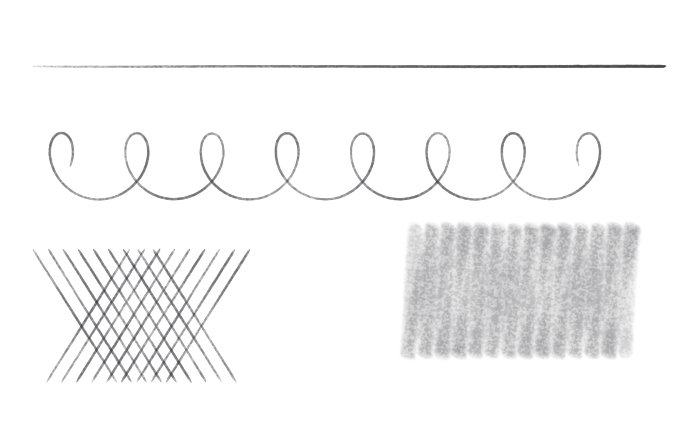
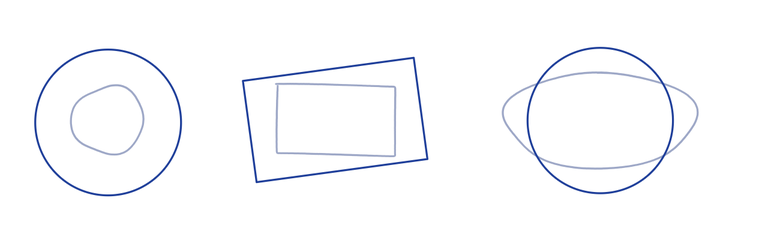
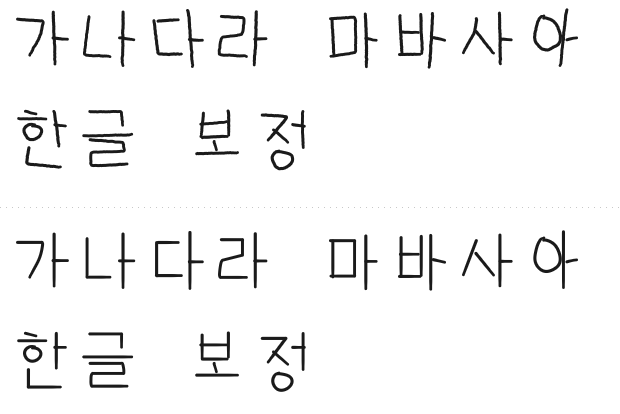
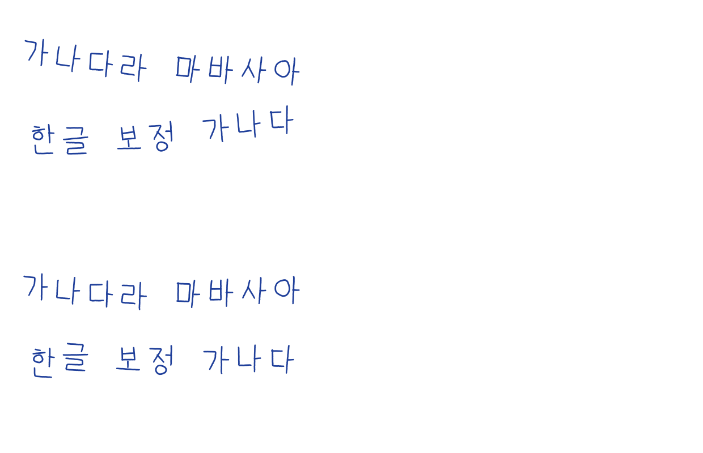
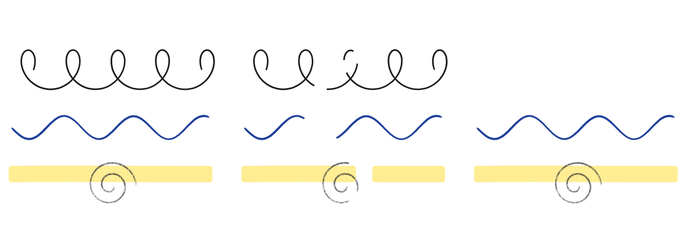

# note-core

iPad 필기 앱 프로젝트입니다. 첫 단계로 앱의 핵심인 **필기 엔진(InkEngine)** 을
크로스 플랫폼 C++17로 작성했습니다. 외부 의존성이 없고, iPadOS(Swift/Metal)뿐 아니라
Android·Windows·macOS·Web(WASM)에서도 같은 코드로 같은 필기감을 냅니다.


위에서부터 볼펜 · 만년필 · 연필 · 붓펜 · 캘리그라피 · 마커 · 형광펜.
모든 이미지는 합성 Apple Pencil 입력(240 Hz, 센서 노이즈·손떨림·필압 변화 포함)을
엔진에 넣고 레퍼런스 래스터라이저로 렌더링한 결과입니다 (`engine/tools/ink_demo`).

## 필기감을 만드는 요소

| 단계 | 구현 | 효과 |
|---|---|---|
| 입력 | 240 Hz coalesced touch, predicted touch, 필압 추정치 갱신(`estimationUpdateIndex`) | 지연 최소화, 정확한 필압 |
| 떨림 제거 | **1€ 필터**(속도 적응형 저역통과) + 선택적 손떨림 보정(당김줄·이동평균, 이비스페인트식) | 느릴 때는 떨림 제거, 빠를 때는 지연 없음 |
| 곡선 | **Centripetal Catmull–Rom** 스플라인 | 빠른 필기에서도 꺾임·고리 없이 매끄러움, 필터링된 모든 제어점을 정확히 통과 |
| 다이내믹스 | 필압 곡선(베지어 LUT), 속도 감응, 시작/끝 테이퍼(들어올리는 속도 반영), 기울기 음영 | 펜마다 고유한 손맛 |
| 정리 | 펜을 뗄 때/댈 때의 미세한 갈고리(hook) 제거, 탭 시 최대 필압 유지 | 깔끔한 획 끝, 또렷한 점 |
| 렌더링 | **SDF 캡슐/닙 프리미티브** + 획 단위 MAX 커버리지 합성 | 어떤 배율에서도 완벽한 안티앨리어싱, 겹침 얼룩 없음 |
| 연필 | 페이지 좌표에 고정된 종이 결(grain) + 필압 깊이 반응 + 틸트 음영 | 실제 흑연 같은 질감, 교차 해칭 시 결이 일치 |
| 형광펜 | 치즐 닙 + Multiply + 획 단위 격리 합성 | 글씨는 그대로 검고, 한 획 안의 겹침은 진해지지 않음 |

## 펜 종류

필기 핵심 펜 3종에 집중하고, 확장 펜을 추가했습니다.

- **볼펜** — 거의 일정한 굵기(필압에 ±15%만 반응), 테이퍼 없음, 완전 불투명. 또렷하고 정확한 필기용.
- **연필** — 필압이 진하기와 종이 결 침투 깊이를 함께 결정. Apple Pencil을 눕히면 넓고 옅은 음영.
- **형광펜** — 세로 치즐 닙(가로 획은 최대 폭, 세로 획은 얇게), 반투명 Multiply. 그린 뒤 펜을 멈추면 직선으로 스냅.
- 만년필 — 필압·속도 감응 굵기, 빠르게 떼면 긴 꼬리.
- 붓펜 — 넓은 필압 범위와 긴 테이퍼.
- 캘리그라피 — 45° 평닙.
- 마커 — 불투명 둥근 펠트 팁.



## 도형 그리기 — 터치를 유지하면 도형으로

대충 그린 뒤 펜을 떼지 않고 잠깐(0.55초) 멈추면 깔끔한 도형으로 바뀝니다.

- **인식 도형**: 직선, 꺾은선(✓ 모양), 호(반원 등), 삼각형, 사각형, 사다리꼴/마름모, 오각형, 육각형, 타원, 원
- **자동 정형화**: 거의 정사각형 → 정사각형, 거의 정삼각형 → 정삼각형(밑변 수평),
  거의 직각 → 정확한 직각삼각형, 거의 정다각형 → 정다각형, 반원은 정확히 180°.
  거의 수평·수직인 선과 변은 정확히 맞춥니다.
- **스냅 후 조절**: 펜을 떼지 않은 채 움직이면 직선은 끝점이 따라오고, 다른 도형은 크기·회전이
  펜을 따라갑니다. 단순히 크기만 바꿀 때 도형이 기울지 않도록 회전에는 6°의 여유 구간이 있습니다.
- **완벽 모드**: 두 번째 손가락을 화면에 대고 있으면(`setShapeConstraint`) 타원 → 원,
  사각형 → 정사각형, 삼각형 → 정삼각형, 다각형 → 정다각형, 직선 → 15° 단위로 고정됩니다.
- **오인식 방지**: 필기(한글 자모, 필기체 고리 등)는 도형으로 바뀌지 않도록 보수적으로 판정하고,
  원을 육각형으로 착각하지 않도록 변이 실제로 곧은지도 검사합니다.

| 위: 그린 그대로 · 아래: 멈췄을 때 | 스냅 후 드래그로 크기·회전 / 완벽 모드(타원 → 원) |
|---|---|
|  |  |

## 글씨 보정

필체는 그대로 두고 흐트러진 부분만 다듬습니다. 강도는 0(끔)–1(강)이고, 펜별로 설정합니다
(`brush.dynamics.correction.strength`, C API `ink_builder_set_correction`).

- **실시간 손떨림 보정**: 쓰는 동안 가벼운 이동평균으로 떨림을 줄입니다(이비스페인트식).
- **획 다듬기(펜을 뗄 때)**:
  - 모서리는 보존하면서 곡선의 떨림만 제거합니다. 지연이 없는 비인과(non-causal) 평활화로,
    원이 작아지지 않도록 수축 보정을 함께 적용합니다.
  - 거의 곧은 구간은 직선으로 펴고, 거의 수평·수직인 구간(ㅡ ㅣ ㄱ ㄴ ㅁ ㄹ)은 정확히 맞춥니다.
    꺾이는 모서리는 이어진 채로 직각이 됩니다.
  - 의도한 사선(ㅅ)과 곡선(ㅇ, 가의 ㄱ)은 모양을 유지합니다.
- **줄 정렬**(올가미로 선택 후 `straighten`): 줄마다 기울기를 없애고, 위아래로 흘러간 단어를
  한 줄에 맞춥니다. 글자 모양은 바꾸지 않고 줄과 단어 단위로만 옮기며, 실행 취소가 됩니다.
- 이미 쓴 글씨에도 적용할 수 있습니다(`PageEditor::correct`, `ink_editor_correct`).

| 위: 보정 없음 · 아래: 보정 강도 1.0 | 줄 정렬 (위: 원본 · 아래: 정렬 후) |
|---|---|
|  |  |

## 기타 기능

- **지우개**: 획 지우개 / 정밀 지우개(벡터 절단 — 잘린 조각이 원래 모양을 그대로 유지),
  "형광펜만 지우기" 같은 종류 필터.
- **올가미 선택**, 이동·확대·회전, 색 변경, 복제, 삭제.
- **실행 취소/다시 실행**: 모든 편집이 가역적인 ChangeSet. 지우개 드래그 한 번 = 실행 취소 한 번.
- **레이어**: 표시/잠금/불투명도.
- **저장 포맷**: 버전 관리되는 바이너리(점당 약 10바이트, 손상된 입력에도 크래시 없음).
- **SVG 벡터 내보내기**(PDF 내보내기의 기반), CPU 렌더링(썸네일·내보내기).



## 구조

```
engine/
  include/ink/        C++ 헤더 (ink.h = 전체 포함)
  include/ink/ink_c.h C API (Swift / Kotlin / C# / Dart / WASM 바인딩용)
  include/module.modulemap   Swift에서 `import InkEngine`
  src/                구현
  shaders/ink_stroke.metal   iPad용 Metal 셰이더 (레퍼런스)
  tests/              단위 테스트 74개
  tools/              데모(PNG 생성), 벤치마크, 합성 입력 생성기
docs/
  ARCHITECTURE.md     엔진 설계와 튜닝 포인트
  IOS_INTEGRATION.md  iPad 앱 연동 가이드 (Swift 예제, Metal 렌더링)
```

## 빌드 & 테스트

```bash
cmake -S engine -B build -DCMAKE_BUILD_TYPE=Release
cmake --build build
./build/ink_tests          # 단위 테스트
./build/ink_demo out       # 샘플 이미지 생성 → out/*.png, out/fountain.svg
./build/ink_bench          # 성능 측정
```

Swift Package (iPad 앱 `note-ipad`가 사용하는 방식, xtool/WSL·Xcode 공통):

```swift
// Package.swift
.package(url: "https://github.com/lemon7679/note-core.git", branch: "main"),
// 타깃 의존성
.product(name: "InkEngine", package: "note-core"),
```

Swift 코드에서는 `import InkEngine`으로 C API만 보이므로 C++ 상호 운용 설정이 필요 없습니다.

iOS 정적 라이브러리:

```bash
cmake -S engine -B build-ios -G Xcode -DCMAKE_SYSTEM_NAME=iOS \
      -DCMAKE_OSX_DEPLOYMENT_TARGET=15.0 -DINK_BUILD_TESTS=OFF -DINK_BUILD_TOOLS=OFF
cmake --build build-ios --config Release
```

## 성능 (Linux x86-64, Release, 단일 스레드)

| 항목 | 결과 |
|---|---|
| 입력 처리 | 샘플당 0.15–0.22 µs (240 Hz 입력 대비 무시할 수준) |
| 실시간 획 갱신 (19초짜리 연속 획, 매 프레임) | 최악 0.07 ms(볼펜) / 0.14 ms(연필) — 증분 처리로 획 길이와 무관 |
| 정밀 지우개 | 이동 1회당 7 µs (획 515개 페이지) |
| 도형 인식 (멈춘 순간 1회) | 7 µs |
| 글씨 보정 (펜을 뗄 때) | 획당 약 30 µs |
| 줄 정렬 (페이지 전체 515획) | 약 37 ms (한 번 실행하는 작업) |
| CPU 전체 페이지 렌더 (A4 @2x, 획 515개) | 약 90 ms (내보내기·썸네일용, 실시간 화면은 GPU) |

## 다음 단계

1. ~~iPad 앱 셸~~ → [`note-ipad`](https://github.com/lemon7679/note-ipad): xtool(WSL) 빌드, 타일 CPU 렌더러,
   NAS(Synology·WebDAV·SMB) 동기화, PDF 뷰어/주석. 이후 Metal 렌더러로 교체 예정
2. 실제 Apple Pencil로 펜별 파라미터 미세 조정 (`engine/src/brush.cpp` 프리셋)
3. 페이지 타일 캐시의 GPU 버전 (`engine/shaders/ink_stroke.metal`)
